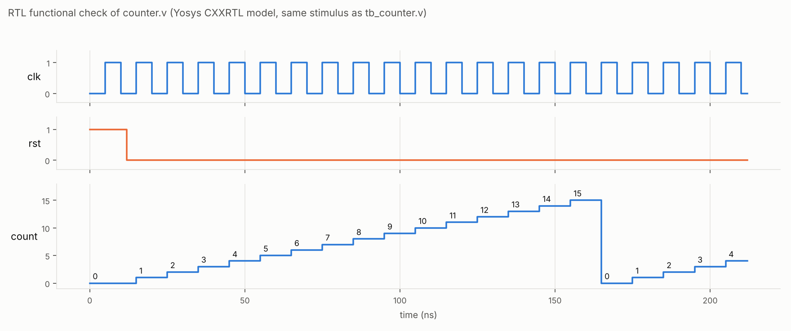
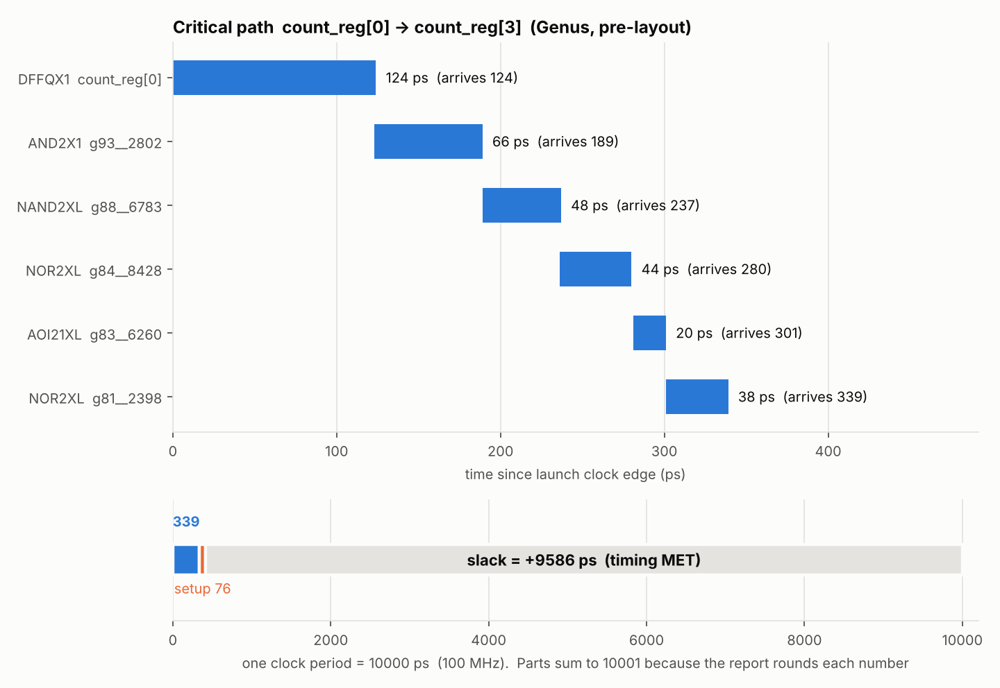
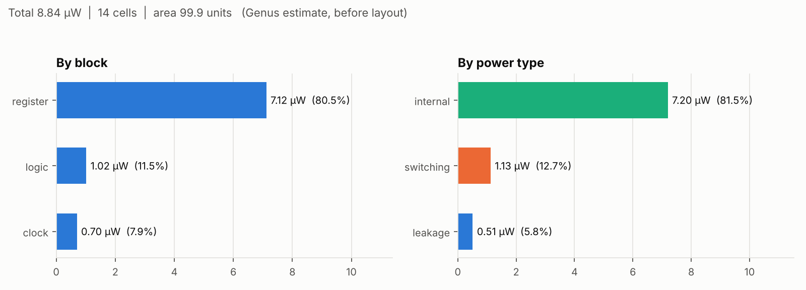
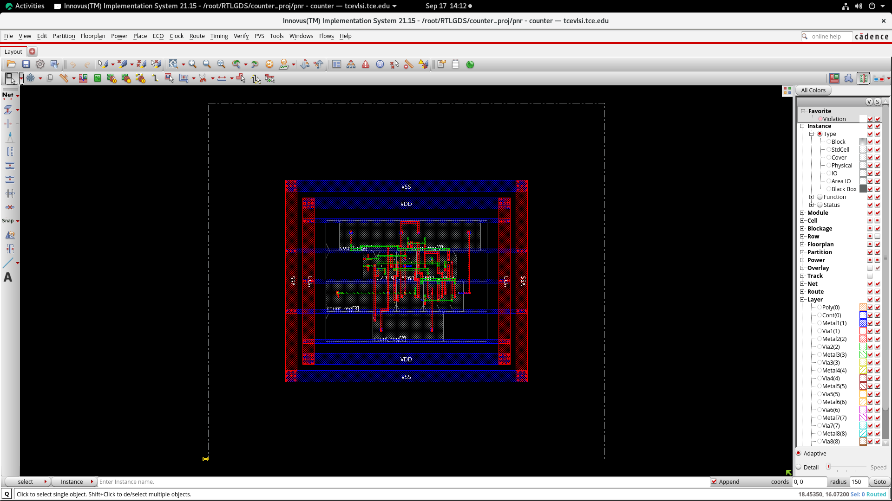

<div align="center">

# 4-Bit Synchronous Counter

**Verilog RTL · Cadence Genus · Cadence Innovus · GPDK090**


A modulo-16 counter with an active-high synchronous reset, taken through synthesis and physical implementation using the **GPDK090 90 nm library environment**.

[Design](#design) · [Waveform](#waveform) · [Results](#synthesis-results) · [Layout](#physical-layout) · [Files](#project-files)

</div>

## Design

The counter increments on each rising clock edge, wraps from **15 → 0**, and resets to zero when `rst` is high at a rising edge.

| Signal | Direction | Description |
| :--- | :--- | :--- |
| `clk` | Input | Rising-edge clock |
| `rst` | Input | Active-high synchronous reset |
| `count[3:0]` | Output | 4-bit count, from 0 to 15 |

```verilog
always @(posedge clk) begin
    if (rst)
        count <= 4'b0000;
    else
        count <= count + 1;
end
```

[Counter RTL](src/rtl/counter.v) · [Testbench](src/rtl/tb_counter.v)

## Design flow

| Stage | Tool | Purpose |
| :--- | :--- | :--- |
| RTL simulation | Cadence Xcelium | Compile and simulate the Verilog design |
| Logic synthesis | Cadence Genus | Map RTL to standard cells and report timing, area, and power |
| Physical implementation | Cadence Innovus | Floorplan, place cells, route, and export the layout |

**Technology:** GPDK090, with `typical.lib` for synthesis and `gsclib090_translated.lef` for physical implementation. These library files are referenced by the scripts and are not included in the repository.

## Waveform



The supplied waveform shows reset, incrementing, and rollover using a **Yosys CXXRTL model**. The original [Xcelium run](src/sim/xrun.log) stopped with an internal exception.

## Synthesis results

Saved Genus reports at typical operating conditions, before physical layout:

| Metric | Value | Report |
| :--- | ---: | :--- |
| Clock constraint | 10 ns / 100 MHz | [SDC](src/syn/counter_constraints.sdc) |
| Mapped cells | 14 | [Area](results/area.rpt) |
| Cell area | 99.911 library units | [Area](results/area.rpt) |
| Reported setup slack | +9.586 ns | [Timing](results/timing.rpt) |
| Estimated total power | 8.836 µW | [Power](results/power.rpt) |

The clock value is a synthesis target; power is a tool estimate.

## Netlist



Generic PDK 90nm process Netlists in Gate Level and Flip-Flop level.

### Timing path



The reported register-to-register path has a **339 ps** data arrival time and positive setup slack under the 10 ns constraint.

### Power breakdown



Registers account for approximately **80.5%** of the estimated total power.

## Physical layout



Innovus layout views and physical exports are included. The saved [implementation log](src/pnr/innovus.log6) reports missing timing libraries, so post-route timing closure is not established.

[Innovus script](src/pnr/invs.tcl) · [Routed netlist](src/pnr/counter_routed.v) · [DEF](src/pnr/counter.def) · [GDS](src/gds/counter.gds)

## Project files

```text
src/
├── rtl/       Counter and testbench
├── sim/       Xcelium logs
├── syn/       Genus script, constraints, netlists, and reports
├── pnr/       Innovus script, logs, and routed outputs
└── gds/       GDS layout
results/       Selected synthesis reports and netlist
assets/        Waveform, charts, and layout screenshots
```

To reuse the Cadence flow, install the licensed tools and GPDK090 libraries, then update the library paths in [syn.tcl](src/syn/syn.tcl) and [invs.tcl](src/pnr/invs.tcl). The scripts use paths relative to their respective directories; Innovus also needs timing-library and constraint setup before timing analysis.
