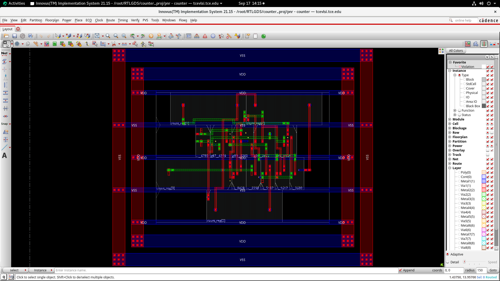
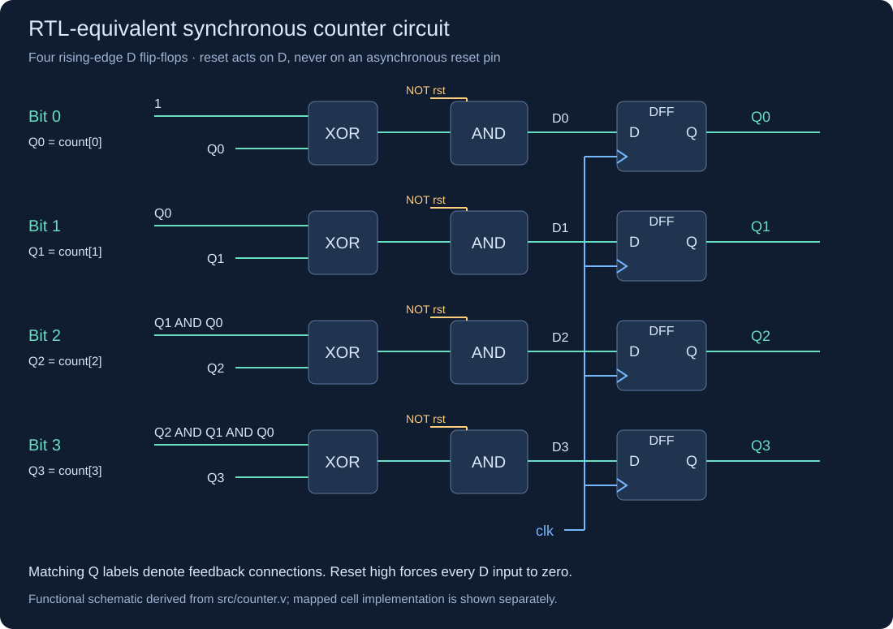
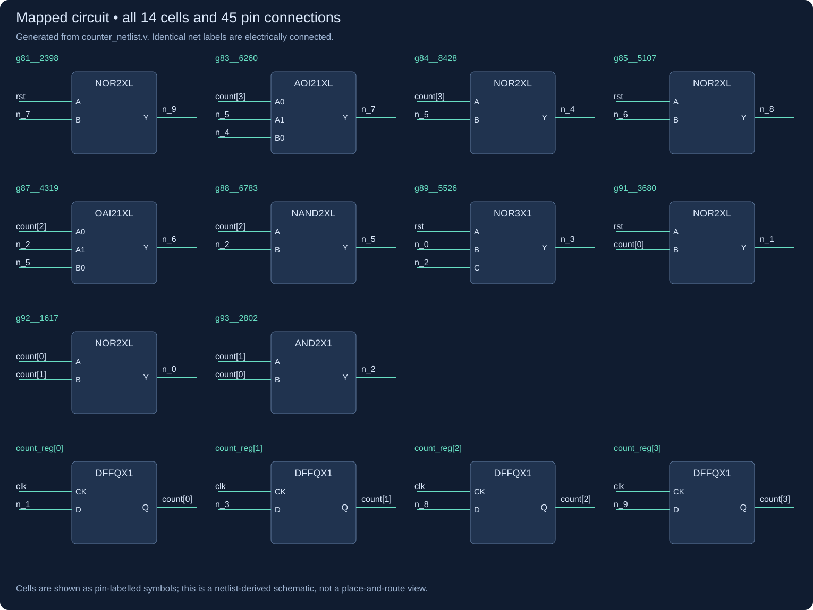
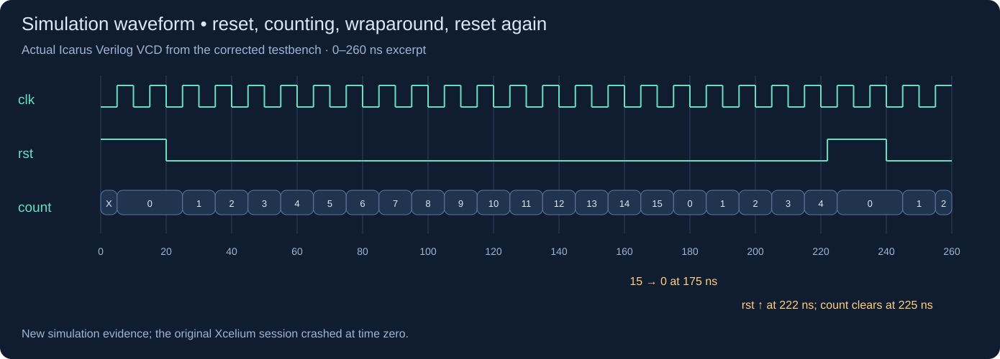
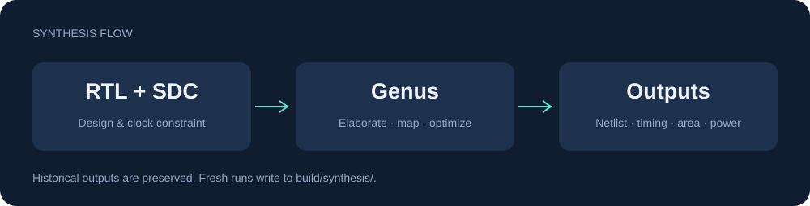
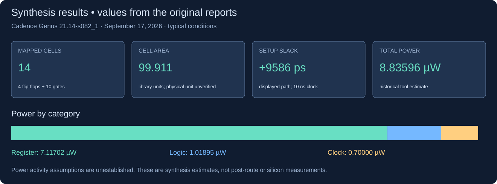

<div align="center">

# 4-Bit Synchronous Counter
### RTL Design · Synthesis · Implementation Experiments

A rising-edge, modulo-16 counter in Verilog, with active-high synchronous reset and a documented Cadence Genus synthesis flow.

**4-bit output** · **16 states** · **10 ns clock constraint** · **14 mapped cells**

</div>



*Original Innovus screenshot, September 17, 2026, 14:15:05. The project includes implementation attempts and failures; this layout image is not a physical-sign-off claim.*

[**Circuit**](#circuit-diagrams) · [**Waveform**](#simulation-waveform) · [**Results**](#synthesis-results) · [**Failures and retries**](#failures-and-retries) · [**Original logs**](docs/run-index.md) · [**Screenshot gallery**](docs/screenshots.md)

## Project status

The completed presentation milestone is **RTL and synthesis**. The full engineering record also includes Xcelium failures and exploratory Innovus placement, routing, DRC, and exports. Original evidence and newly performed verification are both included and labeled.

| Evidence | Status |
| --- | --- |
| Historical Xcelium simulation | Crashed at time zero after compilation/elaboration |
| Historical Genus outputs | Netlist, constraints, timing, area, and power reports preserved |
| Historical Innovus work | Layout and exports exist; failed attempts and timing-library limitations preserved |
| New RTL simulation | 44 clock-edge checks pass |
| New mapped-logic checks | 32/32 cases for each of three netlists |
| New structure check | Netlist/DEF connectivity and GDS reference counts match; not LVS |

## At a glance

The counter increments on each rising clock edge and wraps from 15 to 0. When `rst` is high at a rising edge, the output becomes zero. Asserting reset between edges leaves the current output unchanged until the next rising edge.

```verilog
always @(posedge clk) begin
    if (rst)
        count <= 4'b0000;
    else
        count <= count + 1;
end
```

| Port | Direction | Meaning |
| --- | --- | --- |
| `clk` | Input | Rising-edge clock |
| `rst` | Input | Active-high synchronous reset |
| `count[3:0]` | Output | Unsigned count, 0–15 |

## Circuit diagrams



*Functional circuit derived from the RTL: increment logic feeds four clocked D flip-flops; synchronous reset forces their D inputs to zero. Matching Q labels are feedback connections.*

<details>
<summary><strong>Actual mapped circuit: all 14 cells and pin-level net labels</strong></summary>



Generated from the [saved synthesis netlist](results/netlist/counter_netlist.v). Identical labels denote connected nets. This is a derived schematic, not a Cadence schematic screenshot.

</details>

## Simulation waveform



The plot comes from the [new simulation VCD](results/verification/counter.vcd), showing the 15 → 0 rollover at 175 ns and reset assertion at 222 ns followed by clearing on the 225 ns rising edge. The original Xcelium session failed at time zero; this waveform comes from the corrected Icarus testbench.

## Design flow



This project documents RTL, synthesis, implementation experiments, failures, and independent checks. The saved netlist and synthesis reports are original artifacts from September 17, 2026; the portable scripts and self-checking testbench were prepared on October 30, 2026.

## Synthesis results



*Visualized from the saved reports, with original values and units retained.*

Historical tool: **Cadence Genus 21.14-s082_1**, typical operating conditions.

| Metric | Recorded result | Evidence |
| --- | --- | --- |
| Clock constraint | 10 ns (100 MHz) | [SDC](constraints/counter_constraints.sdc) |
| Mapped cell count | 14: 4 flip-flops + 10 logic gates | [Netlist](results/netlist/counter_netlist.v) |
| Cell area | 99.911 library area units | [Area report](results/reports/area.rpt) |
| Reported setup slack | +9586 ps, displayed path | [Timing report](results/reports/timing.rpt) |
| Estimated total power | 8.83596 µW | [Power report](results/reports/power.rpt) |

The clock value is a synthesis constraint. Area units are not identified in the report; power is a tool estimate with unestablished activity assumptions. These figures have not been recomputed with the original technology library. See [synthesis details](docs/synthesis.md).

## Original Innovus screenshots


*Original 14:12:25 overview, showing power rings and internal routing. The close-up is shown at the top of this README. All five original screenshots, including import/setup views, are in the [screenshot gallery](docs/screenshots.md).*

## Failures and retries

| Attempt | What happened | Original evidence |
| --- | --- | --- |
| Xcelium simulation | Internal exception at time zero | [xrun.log](history/counter_proj/sim/xrun.log) |
| Innovus LEF loading | Undefined Metal1 / failed via creation; loading aborted | [innovus_run.log](history/counter_proj/pnr/innovus_run.log) |
| Constraints command | `read_sdc` rejected | [innovus_run.log3](history/counter_proj/pnr/innovus_run.log3) |
| Floorplan | `core` site invalid | [innovus_run.log4](history/counter_proj/pnr/innovus_run.log4) |
| Power ring | Missing `-layer` argument | [innovus_run.log6](history/counter_proj/pnr/innovus_run.log6) |
| Later physical run | Timing libraries missing; timing graph could not be built | [innovus.log6](history/counter_proj/pnr/innovus.log6) |
| Historical DRC | Report says no violations for that run | [DRC report](history/counter_proj/pnr/counter.drc.rpt) |

Read the [failure and progress guide](docs/failures-and-progress.md) for more attempts, limitations, and evidence. The [complete run index](docs/run-index.md) includes repeated logs, verbose logs, command histories, reports, and crash diagnostics.

## Run locally

Requirements: Python 3 for the netlist checker; Icarus Verilog (`iverilog` and `vvp`) and Make for RTL simulation.

```sh
make sim       # Self-checking RTL simulation; writes build/sim/counter.vcd
make verify    # 32 cases each: synthesis, alternate synthesis, routed netlists
make structure # Netlist/DEF connectivity and GDS cell-reference checks
make visuals   # Regenerate the simulation and documentation SVGs
```

The RTL simulation checks 44 clock edges, counting, wraparound, and synchronous reset. The Python checker checks all 16 states with reset both low and high for each of three netlists using conventional Boolean gate models. It is not a foundry-model simulation or a formal equivalence proof. See [verification](docs/verification.md).

To run synthesis, provide a licensed Genus installation and a compatible Liberty library:

```sh
export COUNTER_LIB=/absolute/path/to/typical.lib
make synthesis
```

New outputs go into ignored `build/`; the committed historical reports remain intact. The relocated synthesis script has not been executed in Genus in this preparation environment.

## Repository map

```text
src/                    Synthesizable Verilog
tb/                    Self-checking testbench
scripts/synthesis/      Portable Genus entry point
scripts/verification/   Boolean mapped-netlist checker
constraints/            Saved synthesis constraints
results/netlist/        Original mapped netlist
results/reports/        Original timing, area, and power reports
results/verification/   Checks run for this repository copy
assets/                 Documentation diagrams
docs/                   Design, failures, run index, gallery, verification
history/counter_proj/   Original RTL, scripts, logs, reports, PNR/GDS outputs
history/earlier-export-141216/  Earlier physical exports
```

## Read more

- [Failures, retries, and evidence](docs/failures-and-progress.md)
- [Complete run-log index](docs/run-index.md)
- [Original screenshot gallery](docs/screenshots.md)
- [Design and reset behavior](docs/design.md)
- [Synthesis setup and report interpretation](docs/synthesis.md)
- [Verification coverage and results](docs/verification.md)
- [Artifact provenance and preparation changes](docs/provenance.md)

## License

A license has not yet been selected. No third-party technology library is included.
