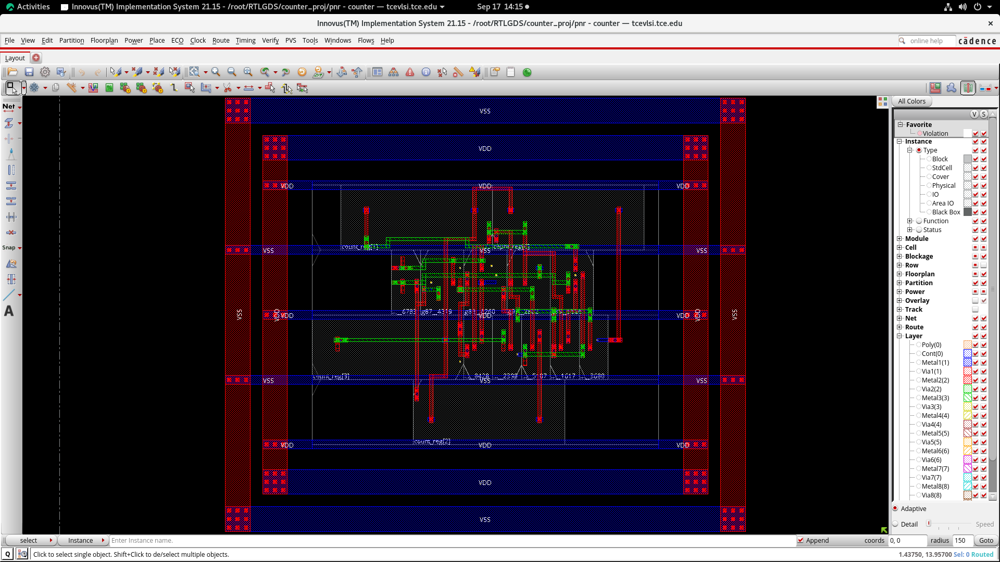

<div align="center">

# 4-Bit Synchronous Counter
### RTL Design · Synthesis · Implementation Experiments

A rising-edge, modulo-16 counter in Verilog, with active-high synchronous reset and a documented Cadence Genus synthesis flow.

**4-bit output** · **16 states** · **10 ns clock constraint** · **14 mapped cells**

</div>


*Original Innovus screenshot, September 17, 2026, 14:15:05. The project includes implementation attempts and failures; this layout image is not a physical-sign-off claim.*

[**Circuit**](#circuit-diagrams) · [**Waveform**](#simulation-waveform) · [**Results**](#synthesis-results) · [**Failures and retries**](#failures-and-retries) · [**Original logs**](docs/run-index.md) · [**Screenshot gallery**](docs/screenshots.md)

## Project status

**A 4-bit synchronous counter designed using the Cadence GPDK090 environment, with RTL, synthesis results, and an experimental physical implementation.**

The repository keeps the working files and the run history together: source code, scripts, reports, tool logs, failed attempts, and layout screenshots. The original Cadence runs date to September 17, 2026. Additional portable verification was performed on October 30, 2026.

| Stage | Recorded outcome |
| :--- | :--- |
| RTL simulation · Xcelium | Compilation and elaboration completed; simulation stopped with an internal exception at time zero. |
| Logic synthesis · Genus | Mapped netlists, timing constraints, and area/timing/power reports were generated. |
| Physical implementation · Innovus | Placement, routing, and physical exports were attempted. Layout views and exports exist, but timing setup remained incomplete. |
| Additional verification | Saved results record 44 RTL clock-edge checks, 32 Boolean cases for each of three netlists, and a structural consistency check. |

## Technology · GPDK090

**This project used GPDK090, Cadence’s Generic 90 nm Process Design Kit environment.** The digital flow references GSCLIB090 standard-cell physical data and a typical-corner Liberty library. The process kit supplies technology context; the standard-cell library supplies the cells used to implement the counter.

| Input | Role in this project | Evidence in the source |
| :--- | :--- | :--- |
| GPDK090 / 90 nm environment | Technology environment used for the project | Original scripts reference the lab’s `FOUNDRY/digital/90nm/dig/` installation. |
| `typical.lib` | Supplies cell information used by Genus for mapping, timing, area, and power estimation | [`src/syn/syn.tcl`](src/syn/syn.tcl) |
| `gsclib090_translated.lef` | Supplies physical library information read by Innovus for implementation | [`src/pnr/invs.tcl`](src/pnr/invs.tcl) |
| `gsclib090site` | Placement-site name recorded for the standard cells | [`src/pnr/innovus_run.log9`](src/pnr/innovus_run.log9) |
| Exported SDC | Records the 10 ns clock and other exported timing settings | [`counter_constraints.sdc`](src/syn/counter_constraints.sdc) |

The Liberty and LEF files are referenced by their original lab paths; they are not bundled here. The precise PDK/library release is not established by this checkout. GPDK090 is a generic design environment; this project does not claim fabrication or silicon measurements.

## The Cadence tools used here

### 01 · Xcelium — simulate the logic

Xcelium compiles the Verilog design and testbench, elaborates their hierarchy, and executes the testbench stimulus to check behavior over time. Here, `xrun` loaded the counter and its testbench, with read/write/connectivity access enabled.

**What happened:** compilation and elaboration completed, but `xmsim` reported `INTERNAL EXCEPTION` at `0 FS + 0`. That session is a failed simulation attempt, not a passing waveform result. The original testbench is retained alongside a separate corrected testbench used for later Icarus verification.

[RTL](src/rtl/counter.v) · [Original testbench](src/rtl/tb_counter.v) · [Run log](src/sim/xrun.log) · [Command history](src/sim/xrun.history)

### 02 · Genus — turn RTL into standard cells

Genus reads the RTL and cell library, elaborates the design, applies the clock constraint, then performs generic synthesis, technology mapping, and optimization. It translates the counter behavior into flip-flops and combinational gates from the available library.

**What it produced:** a mapped Verilog netlist, exported SDC, and timing, area, and power reports. The saved mapping contains **four DFFQX1 flip-flops and ten combinational cells**. These outputs form the synthesis milestone of this project.

[Script](src/syn/syn.tcl) · [Run log](src/syn/genus_run.log) · [Command history](src/syn/genus_run.cmd) · [Mapped netlist](src/syn/counter_netlist.v)

### 03 · Innovus — place and route the mapped design

Innovus takes the mapped netlist and physical library data into the physical-design flow. The saved script initializes the design, creates a floorplan, connects power and ground, adds power rings, places cells, routes connections, and requests Verilog, DEF, and GDS exports.

**What happened:** the work progressed through several failed setup attempts to layout views and physical exports. Later logs still report physical-only initialization, missing timing constraints, and failure to build the timing graph because timing libraries were not loaded. The saved DRC report records no violations for its historical run; full physical sign-off and post-route timing closure are not established.

[Script](src/pnr/invs.tcl) · [Later run log](src/pnr/innovus.log6) · [Command history](src/pnr/innovus.cmd6) · [Physical exports](src/gds/)

## Counter behavior

| Signal | Direction | Function |
| :--- | :--- | :--- |
| `clk` | Input | Updates the register on the rising edge. |
| `rst` | Input | Active-high **synchronous** reset. |
| `count[3:0]` | Output | Four-bit unsigned count, from 0 to 15. |

At each rising edge, asserted reset sets the output to zero; otherwise the counter increments. Four-bit truncation wraps 15 back to 0. Reset asserted between rising edges takes effect at the next rising edge.

```verilog
always @(posedge clk) begin
    if (rst)
        count <= 4'b0000;
    else
        count <= count + 1;
end
```

## Circuit diagrams

The circuit consists of four state flip-flops with combinational increment and reset logic. The [mapped netlist](src/syn/counter_netlist.v) gives the exact cell instances and pin connections.

For a connected schematic, use **[Yosys `show`](https://github.com/YosysHQ/yosys)** with suitable cell definitions, or the schematic view in the original EDA environment. For a manually arranged circuit illustration with standard symbols, **[Circuit Diagram](https://www.circuit-diagram.org/docs)** provides a web editor. A manually drawn figure should be labeled as an illustration; it does not verify the netlist.

## Simulation waveform

The saved [VCD trace](results/verification/counter.vcd) comes from the **corrected testbench run in Icarus Verilog**, not from the failed historical Xcelium session.

| Event in that trace | Time |
| :--- | ---: |
| Counter wraps from 15 to 0 | 175 ns |
| Reset asserted between clock edges | 222 ns |
| Count clears on the next rising edge | 225 ns |

Open the trace in **[Surfer](https://surfer-project.org/)** for a waveform view with signal grouping and time cursors, or **[GTKWave](https://gtkwave.github.io/gtkwave/)**. A useful capture includes `clk`, `rst`, `count`, and `expected`, with the rollover and reset intervals marked. Surfer also has a [VS Code extension](https://marketplace.visualstudio.com/items?itemName=surfer-project.surfer).

The synthesized netlist additionally needs compatible Verilog definitions for its standard cells before it can be simulated. The saved Python checks use Boolean gate models; they are not technology-model gate-level timing simulations.

## Synthesis results

**Cadence Genus 21.14-s082_1 · typical operating conditions · historical reports**

| Measurement | Recorded value | Original report |
| :--- | ---: | :--- |
| Clock period constraint | **10 ns** · 100 MHz | [SDC](src/syn/counter_constraints.sdc) |
| Mapped cell count | **14** | [Area](src/syn/area.rpt) |
| Cell area | **99.911** library area units | [Area](src/syn/area.rpt) |
| Setup slack on the displayed path | **+9586 ps** | [Timing](src/syn/timing.rpt) |
| Estimated total power | **8.83596 µW** | [Power](src/syn/power.rpt) |

<details>
<summary><strong>How to interpret these numbers</strong></summary>

- **100 MHz** describes the synthesis clock constraint, not a measured or post-route maximum frequency.
- **Area** is reported in library units. The report does not establish the corresponding physical area unit.
- **Power** is a historical tool estimate. Activity assumptions have not been established from the supplied evidence.
- These results have not been regenerated with the original technology library in the preparation environment.

</details>

## Physical implementation

The original Innovus views show the power rings and internal routing. They document the implementation work alongside the corresponding logs.


*Original layout overview, September 17, 2026, 14:12:25.*



*Zoomed overview retained from this repository’s local edits.*

</details>

## Failures and retries

Run logs and command histories are part of the project evidence. They show what was executed, where setup failed, and how far each attempt progressed. File suffixes alone should not be treated as a reliable chronological order.

<details>
<summary><strong>Expand the recorded failures and implementation limitations</strong></summary>

| Attempt | Recorded issue | Original log |
| :--- | :--- | :--- |
| Xcelium simulation | Internal exception at time zero | [xrun.log](src/sim/xrun.log) |
| Innovus technology loading | Undefined Metal1; via creation and LEF loading failed | [innovus_run.log](src/pnr/innovus_run.log) |
| Constraint loading | `read_sdc` rejected in the recorded session | [innovus_run.log3](src/pnr/innovus_run.log3) |
| Floorplan | `core` did not match a valid placement site | [innovus_run.log4](src/pnr/innovus_run.log4) |
| Power ring | Required `-layer` argument missing | [innovus_run.log6](src/pnr/innovus_run.log6) |
| DEF import attempt | `source` failed on `VERSION` | [innovus.log4](src/pnr/innovus.log4) |
| Later implementation | Timing libraries missing; timing graph could not be built | [innovus.log6](src/pnr/innovus.log6) |

Later exports do not erase those errors. Physical-only initialization and incomplete timing/RC setup limit what can be concluded from the layout and routing results.

</details>

**Browse the evidence:** [Xcelium files](src/sim/) · [Genus files](src/syn/) · [Innovus files](src/pnr/) · [Saved verification results](results/verification/)

## Reproduce the portable RTL check

From the repository root, with Icarus Verilog installed:

```sh
mkdir -p build/sim
iverilog -g2012 -s tb_counter -o build/sim/counter_sim \
  tb/tb_counter.v src/rtl/counter.v
(cd build/sim && vvp counter_sim)
```

This uses the corrected testbench and writes `build/sim/counter.vcd`. The original testbench remains in `src/rtl/` for comparison. Reproducing the original Cadence runs requires the licensed tools and matching library installation referenced in the source scripts.

The existing Makefile and some supporting documents still refer to the earlier directory layout. The command above follows the current layout; the historical evidence is linked directly throughout this README.

## Repository guide

```text
src/
├── rtl/          Original counter RTL and testbench
├── sim/          Xcelium logs and diagnostics
├── syn/          Genus scripts, logs, netlists, constraints, reports
├── pnr/          Innovus script, command histories, and run logs
└── gds/          Physical exports

results/          Selected reports and saved verification evidence
constraints/      Selected exported timing constraints
assets/           Screenshots and existing visual assets
docs/             Supporting technical documentation
history/          Remaining archive material and earlier exports
```

## Visual authoring options

| What to create | Where to create it | Suggested use here |
| :--- | :--- | :--- |
| Connected netlist schematic | [Yosys](https://github.com/YosysHQ/yosys) | Generate connectivity from Verilog; supply the cell definitions needed for the desired detail. |
| Clean circuit illustration | [Circuit Diagram web editor](https://www.circuit-diagram.org/docs) | Arrange standard symbols, labels, and feedback paths manually. |
| Simulation waveform | [Surfer](https://surfer-project.org/) or [GTKWave](https://gtkwave.github.io/gtkwave/) | Open the actual VCD, group signals, mark events, and capture the relevant interval. |
| Layout figure | Original Innovus session | Capture consistent layer visibility, zoom, and instance labels alongside the relevant run. |

## License

A license has not yet been selected. No third-party technology library is included.
