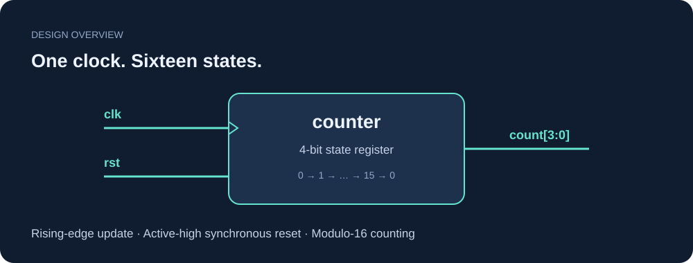

<div align="center">

# 4-Bit Synchronous Counter
### RTL Design · Logic Verification · Synthesis

A rising-edge, modulo-16 counter in Verilog, with active-high synchronous reset and a documented Cadence Genus synthesis flow.

**4-bit output** · **16 states** · **10 ns clock constraint** · **14 mapped cells**

</div>



## At a glance

The counter increments on each rising clock edge and wraps from 15 to 0. When `rst` is high at a rising edge, the output becomes zero. Asserting reset between edges leaves the current output unchanged until the next rising edge.

```verilog
always @(posedge clk) begin
    if (rst)
        count <= 4'b0000;
    else
        count <= count + 1;
end
```

| Port | Direction | Meaning |
| --- | --- | --- |
| `clk` | Input | Rising-edge clock |
| `rst` | Input | Active-high synchronous reset |
| `count[3:0]` | Output | Unsigned count, 0–15 |

## Design flow


This project covers RTL design, simulation, mapped-logic checks, and synthesis. The saved netlist and synthesis reports are original artifacts from September 17, 2026; the portable scripts and self-checking testbench were prepared on October 30, 2026.

## Synthesis results

Historical tool: **Cadence Genus 21.14-s082_1**, typical operating conditions.

| Metric | Recorded result | Evidence |
| --- | --- | --- |
| Clock constraint | 10 ns (100 MHz) | [SDC](constraints/counter_constraints.sdc) |
| Mapped cell count | 14: 4 flip-flops + 10 logic gates | [Netlist](results/netlist/counter_netlist.v) |
| Cell area | 99.911 library area units | [Area report](results/reports/area.rpt) |
| Reported setup slack | +9586 ps, displayed path | [Timing report](results/reports/timing.rpt) |
| Estimated total power | 8.83596 µW | [Power report](results/reports/power.rpt) |

The clock value is a synthesis constraint. Area units are not identified in the report; power is a tool estimate with unestablished activity assumptions. These figures have not been recomputed with the original technology library. See [synthesis details](docs/synthesis.md).

## Run locally

Requirements: Python 3 for the netlist checker; Icarus Verilog (`iverilog` and `vvp`) and Make for RTL simulation.

```sh
make sim       # Self-checking RTL simulation; writes build/sim/counter.vcd
make verify    # Exhaustive 32-case mapped-netlist next-state check
```

The RTL simulation checks 44 clock edges, counting, wraparound, and synchronous reset. The Python checker checks all 16 states with reset both low and high using conventional Boolean gate models. It is not a foundry-model simulation or a formal equivalence proof. See [verification](docs/verification.md).

To run synthesis, provide a licensed Genus installation and a compatible Liberty library:

```sh
export COUNTER_LIB=/absolute/path/to/typical.lib
make synthesis
```

New outputs go into ignored `build/`; the committed historical reports remain intact. The relocated synthesis script has not been executed in Genus in this preparation environment.

## Repository map

```text
src/                    Synthesizable Verilog
tb/                    Self-checking testbench
scripts/synthesis/      Portable Genus entry point
scripts/verification/   Boolean mapped-netlist checker
constraints/            Saved synthesis constraints
results/netlist/        Original mapped netlist
results/reports/        Original timing, area, and power reports
results/verification/   Checks run for this repository copy
assets/                 Documentation diagrams
docs/                   Design, synthesis, verification, provenance
```

## Read more

- [Design and reset behavior](docs/design.md)
- [Synthesis setup and report interpretation](docs/synthesis.md)
- [Verification coverage and results](docs/verification.md)
- [Artifact provenance and preparation changes](docs/provenance.md)

## License

A license has not yet been selected. No third-party technology library is included.
