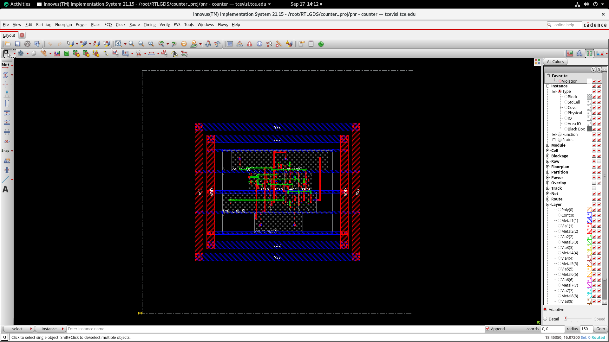
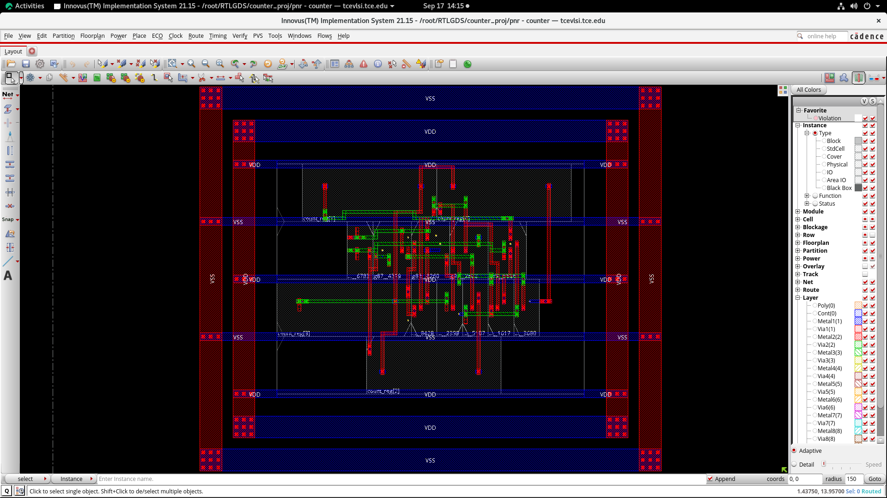
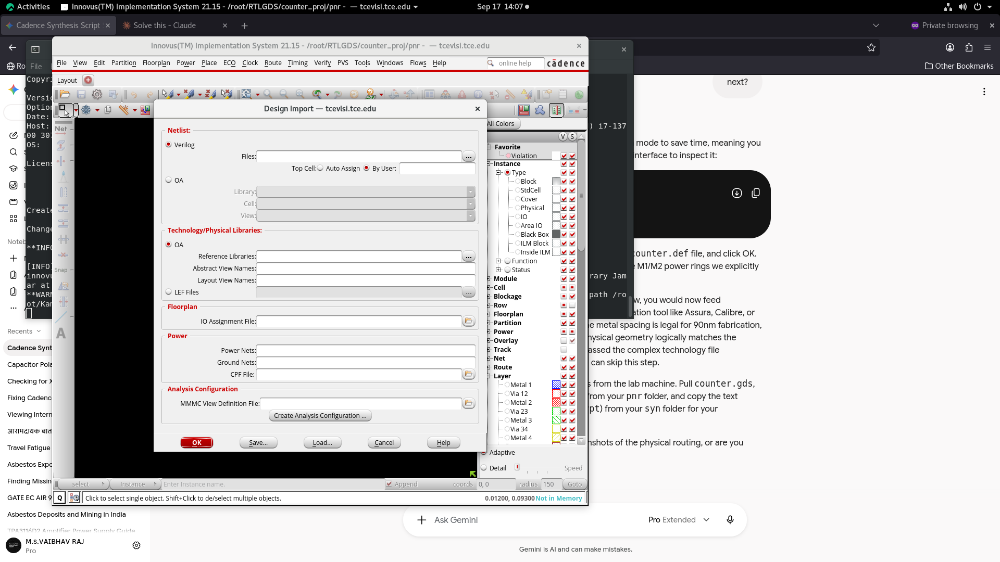
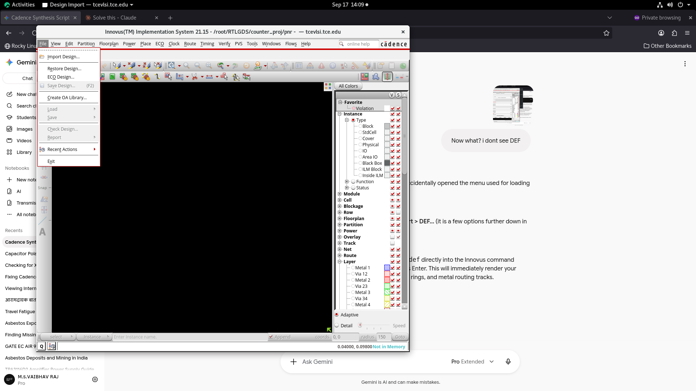
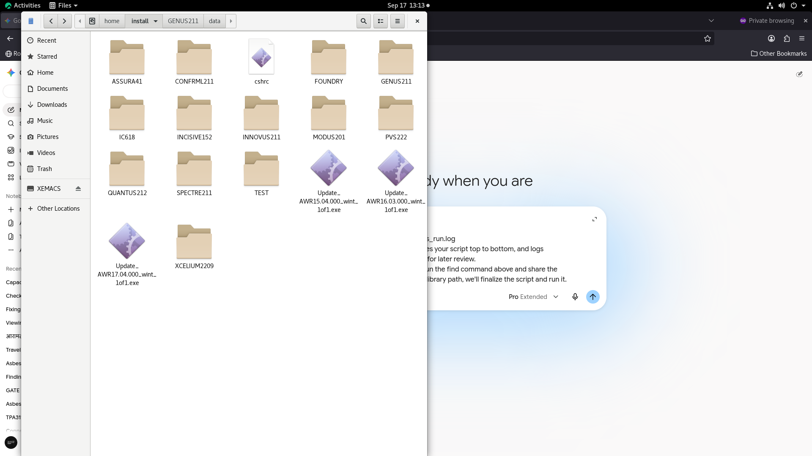

# Original screenshot gallery

These five PNGs are copied byte-for-byte from the source archive. Names below describe the visible contents. Dates/times come from the original filenames and desktop clocks. Screenshots are historical observations, not fresh tool runs.

## Layout overview · September 17, 2026, 14:12:25

The Innovus canvas shows the counter layout with VDD/VSS rings, internal wiring, and instance labels. This view predates the later 17:02 exports.

## Layout detail · September 17, 2026, 14:15:05

A closer view of the power rings and internal routes. Neither screenshot proves complete timing or physical sign-off.

## Design import · September 17, 2026, 14:07:17

The design-import dialog shows netlist, physical-library, and analysis-configuration fields; it is setup evidence.

## Import menu · September 17, 2026, 14:09:00

The menu and empty canvas document the UI exploration before the layout views.

## Tool environment · September 17, 2026, 13:13:32

Installation-folder view. It does not demonstrate a successful tool run.
